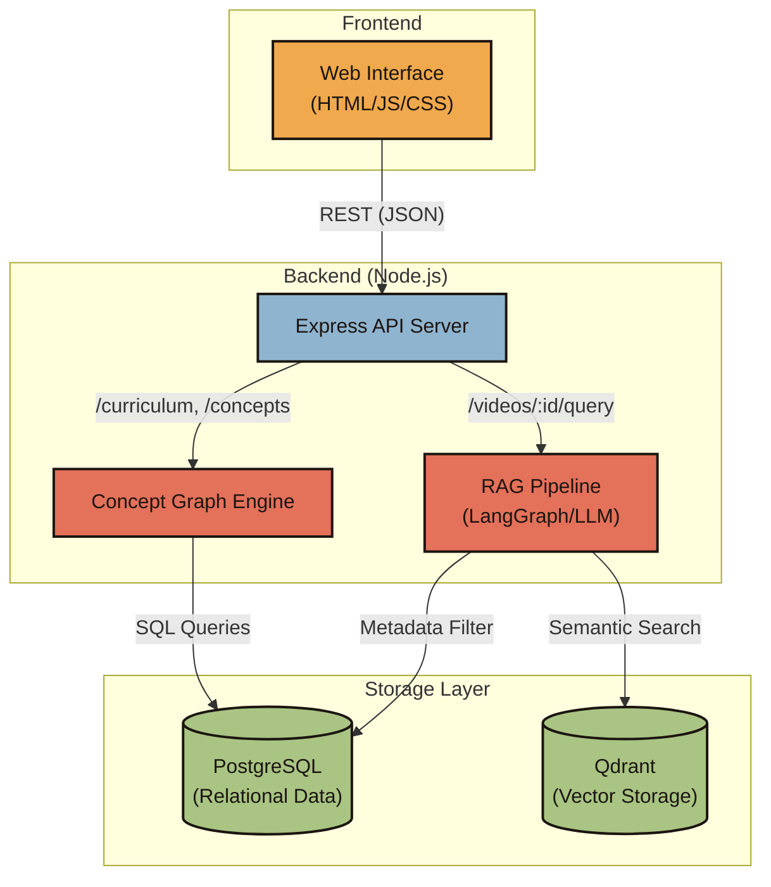
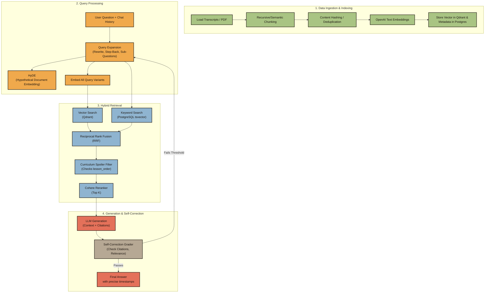

# Course Study Assistant

The **Course Study Assistant** is a comprehensive learning companion designed to help students navigate a course curriculum (in this case, React Native & Expo), ask questions, and track their progress in an empathetic and interactive environment. It utilizes a hybrid Retrieval-Augmented Generation (RAG) system with a Node.js API backend and a dynamic HTML/JS frontend.

## Architecture



The project has been restructured for clarity and deployment readiness into two main directories:

### 1. `backend/`
The API server that powers the assistant, built with Node.js and Express.
- **Database:** Uses PostgreSQL (with pgvector) for relational data and chunk metadata.
- **Vector Storage:** Uses Qdrant for semantic search and fast vector retrieval.
- **RAG Pipeline:** Leverages LangChain (or a custom graph implementation) to process student questions against the curriculum, taking into account their current progress in the course to prevent spoilers.
- **Key Endpoints:**
  - `/curriculum` - Provides the course structure and modules.
  - `/videos/:videoId/query` - Answers specific questions about a lesson.
  - `/concepts` - Explains course concepts and their prerequisite chains.
  - `/health` - Checks the status of Postgres and Qdrant services.

### 2. RAG Pipeline (Retrieval-Augmented Generation) Deep-Dive

The backend features an advanced, multi-stage RAG pipeline orchestrated via **LangGraph**. It goes far beyond naive vector search, utilizing state-of-the-art techniques to ensure high accuracy, prevent course spoilers, and provide exact timestamps for every claim.



#### Step-by-Step Pipeline Execution:

**1. Data Ingestion & Pre-processing (`src/ingestion/`)**
- **Loaders**: Supports `.srt`, `.vtt`, `.json`, `.pdf`, and `.md`. Subtitles are parsed to extract clean text while retaining precise `startTime` and `endTime` markers.
- **Chunking**: Applies `RecursiveCharacterTextSplitter` (with configurable size and overlap) to ensure context isn't lost at chunk boundaries.
- **Deduplication**: Hashes the content to prevent re-embedding identical text across pipeline runs.
- **Dual Storage**: 
  - **Qdrant**: Stores the OpenAI embeddings (`text-embedding-3-small`) for fast cosine-similarity search.
  - **PostgreSQL**: Stores the full text payload, the `lesson_order` (from the curriculum spine), and a `tsvector` index for keyword search.

**2. Query Processing & Expansion (`src/nodes/queryExpansion.js` & `hyde.js`)**
- **Contextual Rewrite**: The LLM looks at the chat history and the user's raw query to resolve pronouns and implicit context.
- **Query Expansion**: The LLM generates multiple searchable variations simultaneously:
  - A *Semantic Rewrite*.
  - A *Step-Back Query* (a broader, more abstract version of the question).
  - 2-4 *Sub-Questions* to tackle multi-part queries.
- **HyDE (Hypothetical Document Embeddings)**: The system generates a "fake" ideal answer to the question using the LLM, which is then embedded to find chunks in the vector database that match the *answer's* semantic signature, rather than the *question's*.

**3. Hybrid Retrieval & Reranking (`src/nodes/retrieve.js` & `rerank.js`)**
- **Parallel Search**: Executes vector searches in Qdrant (using all expanded query variants + the HyDE document) alongside a full-text keyword search (`websearch_to_tsquery`) in PostgreSQL.
- **Curriculum Filtering**: (The "Spoiler Filter"). It strictly bounds the `lesson_order` in the SQL `WHERE` clause and Qdrant filters. If a student is on Lesson 10, material from Lesson 11+ is excluded from the primary context pool.
- **Lookahead Probe**: Simultaneously, it does a quick background probe *ahead* of the student's position. If the answer genuinely lives in a future lesson, the system can gracefully tell the user "That is coming up in Module X" instead of hallucinating.
- **Reciprocal Rank Fusion (RRF)**: Merges the results from all the vector and keyword searches, scoring them based on their relative ranks across the different lists.
- **Cohere Reranker**: Passes the top RRF results to Cohere's `rerank-v3.5` API, sorting the chunks by true contextual relevance rather than raw semantic distance.

**4. Generation & Self-Correction (`src/nodes/generate.js` & `grade.js`)**
- **Context Assembly**: The reranked chunks are formatted into XML-style `<source>` blocks containing the lesson title, order, and exact video timestamp.
- **Instruction Prompting**: The LLM (`gpt-4o-mini` or similar) generates the answer, strictly instructed to cite the sources inline as `[1], [2]`.
- **The Grader (Self-Correction)**: Before returning the answer to the user, a secondary LLM call grades the draft response.
  - It checks for **Groundedness**, **Relevance**, and **Citation Accuracy**.
  - If the model hallucinated a citation number (e.g., citing `[4]` when only 3 chunks were provided), or if the answer fails the score threshold, the pipeline routes *back* to the expansion/generation nodes to try again (up to a `maxAttempts` limit).
- **Concept Graph Integration (`src/concepts.js`)**: Offline, the transcripts are processed to build a dependency graph of concepts (e.g., "React Hooks" requires "React Basics"). This allows the frontend to show prerequisite chains and gap analysis based on the student's current position.

### 3. `frontend/`
The web interface designed with an "Ember Glow" design system. It focuses on warmth, empathy, and providing a premium learning experience without requiring a heavy frontend framework.
- **`public/index.html`**: The main entry point, structured with semantic HTML.
- **`public/styles.css`**: The styling layer featuring glassmorphism, responsive layouts, and soft animations.
- **`public/app.js`**: The interaction layer managing state, API calls, and dynamic UI updates.
- **`preview.mjs`**: A Node.js script for mocking the frontend environment during local UI development.

---

## Core Functionalities

### The Learning Spine (Course Timeline)
- **Visual Progress:** A draggable timeline representing the course modules and lessons.
- **Contextual Awareness:** The assistant knows where you are in the course. When you ask a question, it filters out "future" material to avoid spoilers, or explicitly warns you if an answer requires knowledge you haven't reached yet.
- **Dynamic Feedback:** Clicking a point on the timeline visually updates your progress and triggers celebratory animations when passing milestones (25%, 50%, etc.).

### Intelligent Q&A (Ask Tab)
- **Multiple Modes:** You can ask direct questions, request summaries, generate quizzes, or ask for a "catch-up" on previous material.
- **Contextual Citations:** Answers include clickable citations pointing back to the specific lesson and timestamp where the concept was taught.
- **Empathy & Encouragement:**
  - The UI tracks consecutive study days to show a "Streak".
  - Offers personalized greetings based on the time of day.
  - Provides encouraging banners if an answer requires concepts from future lessons ("Great curiosity!").

### Concept Graph (Concepts Tab)
- **Knowledge Mapping:** Search for any concept taught in the course.
- **Prerequisite Tracking:** Shows what you need to know *before* tackling a concept, and highlights which prerequisites you haven't reached yet.
- **Course Integration:** Distinguishes between "core" concepts (structural to the course) and "details" (one-off implementation notes).

## UI/UX Enhancements
The frontend was recently overhauled to prioritize user experience and empathy:
- **Glassmorphism:** Soft, translucent card components that give depth to the interface.
- **Micro-interactions:** Ripples, smooth tab transitions, and hover states that make the app feel alive.
- **Skeleton Loaders:** Replaced static "Loading..." text with animated skeleton placeholders to reduce perceived wait times.
- **Typing Indicators:** Simulates "thinking" time with bouncing dots while the backend processes complex queries.

## Getting Started

### Prerequisites
- Docker and Docker Compose (for running Postgres and Qdrant locally)
- Node.js v22+

### Running the App
1. Ensure the backing services (Database) are running using Docker Compose:
   ```bash
   docker-compose up -d
   ```
2. In a terminal, start the backend API:
   ```bash
   npm run serve
   ```
3. To work purely on the frontend UI without the full backend (mocked data):
   ```bash
   cd frontend
   node preview.mjs
   ```
   *Then open `http://localhost:4000` in your browser.*

---
*Happy Studying!*
